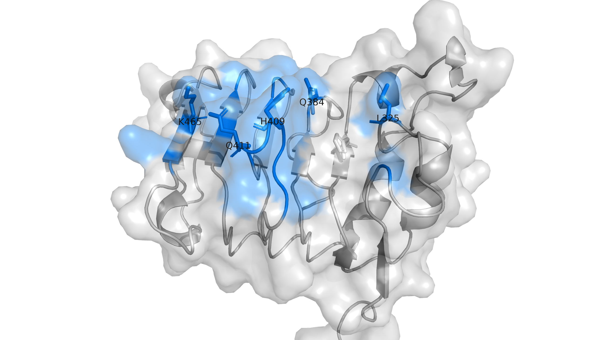
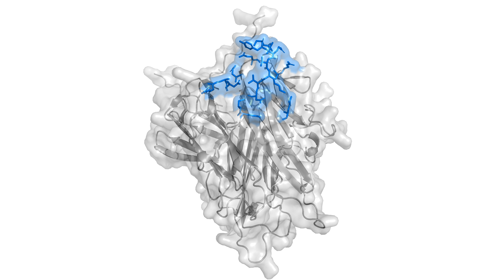
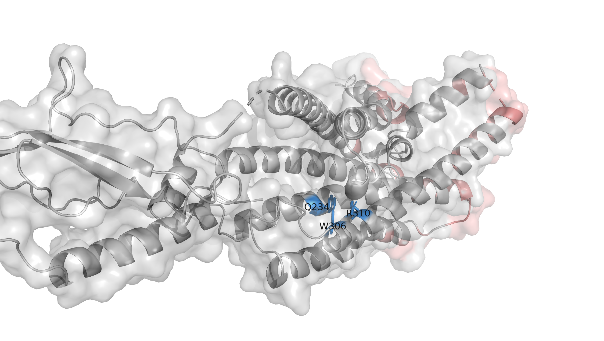
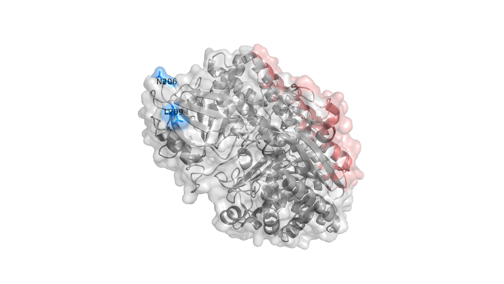
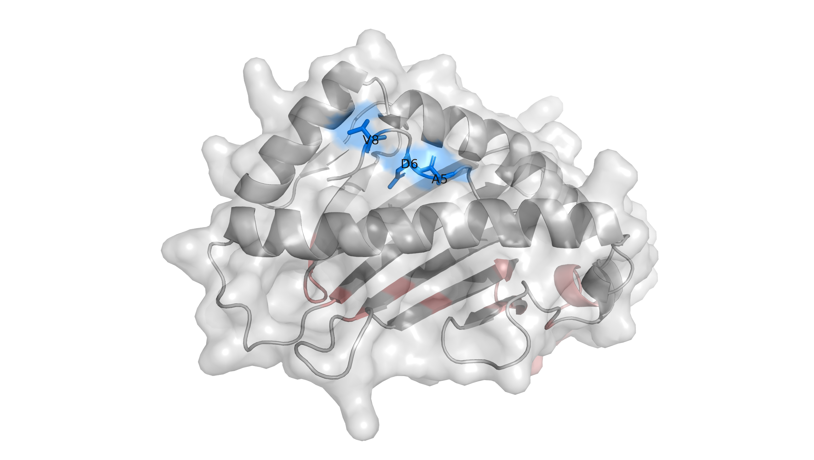

[← Series homepage](../index.html)

# AI-powered protein design: five targets closer to real drug development

*Article 1 of 3 · November 2026*

Anthropic and Adaptyv hosted a five-challenge protein design competition beginning on September 28, 2026, with the final submission deadline on November 9. Challenges opened on successive Mondays, with overlapping design windows and some deadline adjustments. [The official schedule and participation rules](https://proteinbase.com/competitions/anthropic-adaptyv-2026) describe three tracks: research labs and companies, supported individual researchers and small teams, and a self-supported open track. My colleague and I participated in Track 3, partly to have fun and partly to explore what AI agents could contribute to scientific work.

One unusual feature was the selection process. Submissions from Tracks 2 and 3 were pooled for a Claude-based workflow to recommend designs for laboratory testing, with final approval by people at both organizers. The [selection prompt is public](https://proteinbase.com/competitions/anthropic-adaptyv-2026/selection).

Our main focus was testing an AI co-scientist workflow rather than developing a new protein-design algorithm. We submitted designs to all five challenges. Agents generated hypotheses, performed much of the analysis and operational work, and reviewed the resulting evidence. Our role as humans included setting priorities, challenging decisions, authorizing consequential runs and completing submissions.

Before describing the agentic workflow, it helps to understand the scientific task. Each challenge asked for binding to a target, but affinity alone could not satisfy the full objective. Some designs needed to respond to pH, some needed to recognize both human and mouse proteins, one needed to activate a receptor, and another needed to discriminate a single amino-acid change.

## What distinguished this competition

Earlier competitions already connected computational design to experimental testing. Adaptyv's [2024 EGFR competition](https://proteinbase.com/competitions/adaptyv-egfr-binder2) and [Nipah competition](https://proteinbase.com/competitions/adaptyv-nipah-competition) described affinity-based winner rankings. They also had therapeutic motivations; function was not a new concern introduced here.

What stood out in this competition was the combination of **five targets, explicit conditional or functional objectives, and encouragement to use language-model tools in the design process**. A good interface in one structure was only part of the question. We also had to ask what would happen under a different pH, against another species or target state, or in a functional assay.

> **Figure 1. Competition theme illustration.** Image linked from the [official Anthropic × Adaptyv competition website](https://proteinbase.com/competitions/anthropic-adaptyv-2026). Credit: Anthropic / Adaptyv / Proteinbase. This third-party illustration is not a result from our project; see the [rights notice](../reuse.html#third-party-material).

## Five targets and the requirements beyond affinity

The table summarizes biological objectives. Eligibility for submission, selection for testing and winning were separate questions.

| Target | Binding objective | Additional objective | Structural question for the agents |
|---|---|---|---|
| [EGFR](https://proteinbase.com/competitions/anthropic-adaptyv-2026/challenges/egfr) | Bind human extracellular EGFR at pH 6.5 | No detectable human binding at pH 7.4; recognize mouse EGFR at pH 6.5 | Can a conserved surface support acid-favored binding? |
| [TNF-α](https://proteinbase.com/competitions/anthropic-adaptyv-2026/challenges/tnf-alpha) | Bind human TNF at pH 7.4 | Release at pH 6.0; recognize mouse TNF at pH 7.4 | Can an interface on the trimer retain neutral-pH binding while becoming unfavorable in acid? |
| [GLP1R](https://proteinbase.com/competitions/anthropic-adaptyv-2026/challenges/glp1r) | Bind human GLP1R | Activate the receptor in a functional assay | Can a designed scaffold reach an activation-relevant pocket in receptor context? |
| [TfR1](https://proteinbase.com/competitions/anthropic-adaptyv-2026/challenges/tfr1) | Bind human TfR1 at pH 7.4 | Release at pH 6.0; recognize mouse TfR1 at pH 7.4 | Can an accessible site accommodate species differences, the dimer and surrounding context? |
| [KRAS-G12D pMHC](https://proteinbase.com/competitions/anthropic-adaptyv-2026/challenges/pmhc) | Bind mutant peptide presented by HLA-A*11:01 | Reject WT peptide–HLA and peptide-free HLA/β2m | Does the interface read the mutation and peptide rather than shared HLA? |

The pH direction is important: **EGFR should favor acid, whereas TNF and TfR1 should release in acid.** GLP1R adds a different distinction: binding is measured separately from signaling. Binding-only entries can appear in affinity rankings, while winning requires activation as well.

## How the agents translated objectives into structural hypotheses

An epitope is the surface recognized by a binder. The organizers suggested broad functional regions; the agents investigated specific patches and design guidance within that context. Those choices were hypotheses to test, not validated binding sites for our designs.

### EGFR: a conserved patch around target histidines

The organizers recommended domain III. The agents narrowed the proposal to a surface around **H409**, with **H346** considered as a second titratable site, using mature EGFR numbering. The idea was to exploit histidines already present on the target: changes in protonation could alter interactions with a designed binder.

The recorded H409 patch contained 16 exposed residues, 15 identical in the mouse alignment. Comparison across experimental structures supported a relatively stable patch, while an outlier motivated flexibility around residues 406–411.

That reasoning supplied a site and mechanism proposal. Subsequent pKa calculations gave limited support for the desired switch; contact with a histidine did not establish the required response.

> **Figure 2. An H409-centered design hypothesis on EGFR domain III.** The blue surface marks the recorded 16-residue patch on the 6ARU-derived chain-A target; L325, Q384, H409, Q411 and K465 are labeled hotspot residues. Numbers refer to mature EGFR; add 24 for UniProt P00533 precursor numbering. H346 was investigated separately and is not labeled here. This target crop illustrates site selection, not an experimentally demonstrated pH switch. [Structural reference: 6ARU](https://www.rcsb.org/structure/6ARU).

### TNF: design against the trimer, then examine the chemistry

TNF required the opposite pH behavior. The agents worked with the **trimer**, selecting an inter-protomer patch around **V91** rather than treating an isolated subunit as the target. In the recorded reference, the patch spans residues on chains A and C.

The proposed mechanism emphasized binder histidines whose protonation might destabilize binding in acid. Human–mouse alignment exposed a tradeoff: the patch included charge-changing differences, so a chemically attractive human interface could still be a poor cross-species hypothesis.

Review later challenged some of the geometric evidence supporting the strategy. That trajectory belongs in Article 3; the initial lesson here is that assembly, species and atom-level chemistry all mattered to site selection.

> **Figure 3. A proposed inter-protomer epitope on TNF-α.** Blue marks the 17 residue copies selected across chains A and C of the canonical-sequence predicted trimer used for design: A85–92, A125, A127, A131, A135, C32–34 and C146–147. Gray shows the remaining target surface. Numbers refer to the mature 157-residue TNF chain. The image shows the target patch; no designed binder or histidine-mediated interaction is depicted.

### GLP1R: reaching a pocket does not establish activation

The agents investigated an extracellular approach to the receptor's orthosteric pocket. One pilot used **Q234, W306 and R310** as guidance residues because they contacted the native ligand's N-terminal region in the reference analysis.

The design intent was a compact scaffold with a pocket-reaching loop or tip, without copying the natural agonist sequence. The receptor's transmembrane context, access path and the binder's terminal presentation all affected whether that geometry was plausible.

These residues were generation guidance, not an agonist pharmacophore. A pose in an active-state receptor structure could not establish signaling, and the campaign ultimately retained exploratory binding hypotheses with unresolved activation evidence.

> **Figure 4. Pocket guidance and intracellular avoidance on GLP1R.** Blue marks Q234, W306 and R310 in canonical human numbering; salmon marks the proposed 29-residue intracellular-side avoidance map. The target is a WT-reverted, sparsely resolved 6X18-derived receptor preparation: full sequence representation does not supply coordinates for missing regions. No membrane plane is shown. The colors describe design guidance, not a validated agonist pharmacophore or an enforced membrane barrier. [Structural reference: 6X18](https://www.rcsb.org/structure/6X18).

### TfR1: an accessible site within a complicated dimer

The organizers recommended the apical domain. The agents evaluated a more specific initial pilot site using **N206/L209 on chain A of 11QC**, considering exposure and conservation while retaining the full A/B dimer as reference context.

This choice also required attention to glycans, the second receptor subunit and transferrin compatibility. A reduced generation target lowered the represented system size, but its apparent accessibility still had to be examined against the omitted context.

The highlighted guides describe that pilot decision, not every later candidate's footprint. The competition's binding measurements would not by themselves demonstrate brain transport, even though TfR1 is relevant to that application.

> **Figure 5. Pilot guidance on a single-chain TfR1 proxy.** Blue marks N206 and L209 on chain A of the 11QC-derived target, using canonical/author numbering. Salmon marks the proposed avoidance surface intended to discourage binding near the omitted dimer partner. Only the single receptor chain is depicted; the full A/B dimer remained the evaluation reference. The initial 112-residue and later 71-residue avoidance prescriptions were distinct from the successful diagnostic arm, which requested no avoidance selections. Neither this view nor the guidance establishes dimer compatibility, pH switching or brain transport. [Structural reference: 11QC](https://www.rcsb.org/structure/11QC).

### KRAS-G12D pMHC: recognizing the difference

Here the agents had to focus on the peptide presented in HLA rather than the much larger shared platform. **Asp6 in the mutant peptide replaces Gly6 in WT.** Generation explored guidance at Asp6 and, in other arms, neighboring Ala5/Val8. Local peptide flexibility allowed the target to move around the proposed interface.

That flexibility created another question: did a candidate depend on a generated peptide conformation that differed from the experimental reference? Later mutant/WT and conformer comparisons tested parts of that uncertainty.

Our generation target was a peptide–HLA platform crop. Available distal HLA/β2m context was restored for subsequent checks; it should not be depicted as if the full assay complex had been used throughout generation.

> **Figure 6. Peptide-focused guidance for KRAS-G12D pMHC design.** The 7OW6-derived design crop contains HLA-A*11:01 residues 1–182 and the separate ten-residue peptide VVVGADGVGK. Blue highlights peptide A5, D6 and V8; generation used either D6 or the alternative A5/V8 pair. D6 corresponds to KRAS Asp12 and is Gly6 in the WT peptide, which is not shown. Salmon marks HLA background/cut-face avoidance residues. The HLA α3 domain and β2-microglobulin were omitted from generation and are not depicted. A contact with the mutant peptide alone would not establish mutant specificity. [Structural reference: 7OW6](https://www.rcsb.org/structure/7OW6).

## What this first stage taught us

The agents turned broad biological goals into concrete choices: which assembly to use, where to place a binder, which residues to guide toward, and which counterstates to examine. Those choices made the work testable. They also introduced assumptions that later analyses and reviews had to challenge.

All five challenges have been submitted. We do not yet have experimental binding or functional results for these designs. This series therefore examines the reasoning and evidence behind the hypotheses. Article 2 will describe the collaboration that produced them; Article 3 will follow decisions that changed, failed or missed an important question.

---

Original article text and project-created figures: all rights reserved. Commercial use and redistribution require prior written permission, subject to applicable law and platform terms. Third-party material retains its own rights. See [copyright and reuse](../reuse.html).
