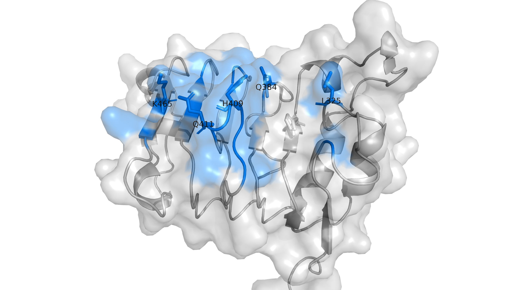

# AI agents in protein design

**Five targets. Different biological demands. A human-directed AI co-scientist workflow.**

What happens when AI agents have to reason beyond binding affinity—to pH switching, cross-species recognition, receptor activation and a single amino-acid difference?

My colleague and I explored that question in the **Anthropic × Adaptyv Protein Design Competition**. We submitted designs to all five challenges, using agents to propose hypotheses, run analyses and review evidence while we directed the work and made the final decisions.

This series follows the reasoning behind those designs. Experimental performance has not yet been established in the evidence presented here.

## Start with the science

### [1. AI-powered protein design: five targets beyond binding affinity](articles/01-five-targets.html)

Meet EGFR, TNF-α, GLP1R, TfR1 and KRAS-G12D pMHC. See how the agents translated biological objectives into specific structural hypotheses—and why an attractive interface was only the beginning.

[**Read the first article →**](articles/01-five-targets.html)

## Next in the series

**2. How the agents collaborated** · In preparation

The roles, handoffs, persistent state, reviews and human interventions behind the scientific work.

**3. What the decision trajectories revealed** · In preparation

The assumptions, failures and counterexamples that changed our decisions.

---

An independent participant account. [Official competition](https://proteinbase.com/competitions/anthropic-adaptyv-2026) · [Repository](https://github.com/yshen25/anthropic-adaptyv-protein-design-competition) · [Copyright and reuse](reuse.html)
